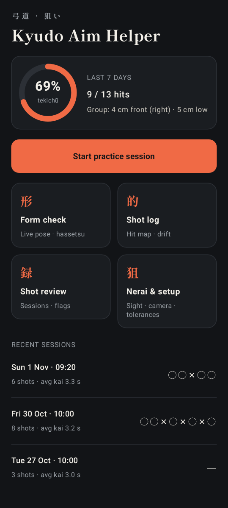
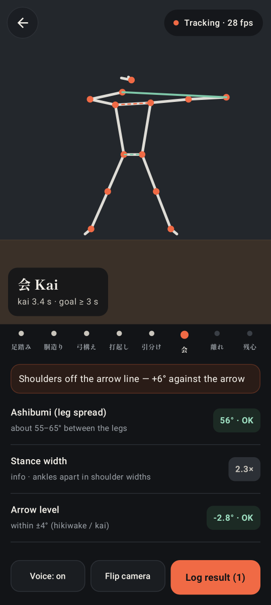
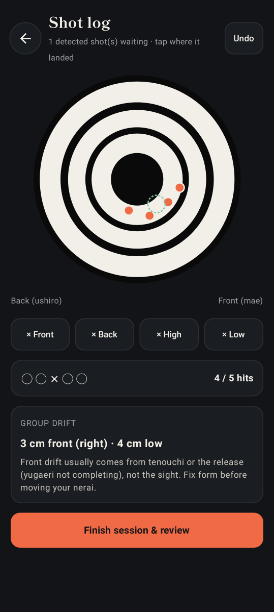
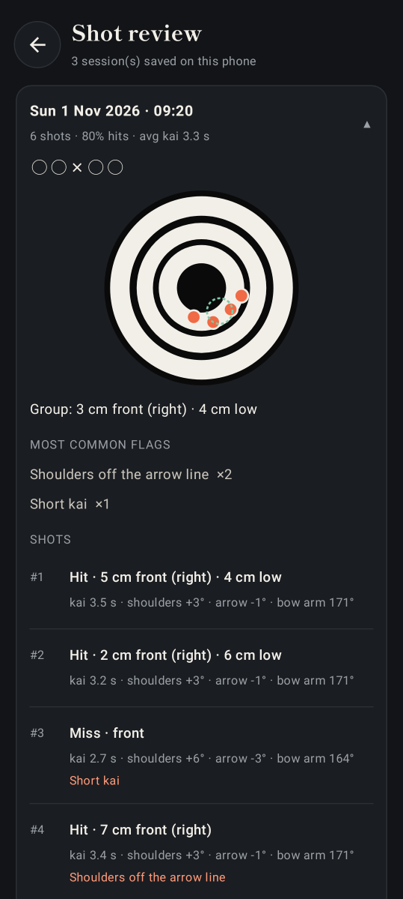
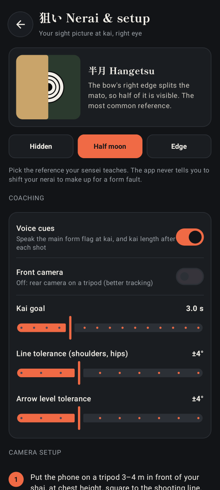

# Kyudo Aim Helper — Android POC

[](https://github.com/G2454/KyudoAim/actions/workflows/android.yml)
[](https://github.com/G2454/KyudoAim/actions/workflows/screenshots.yml)

An on-device training helper for kyudo. The phone stands on a tripod in front of the archer and:

- **Form check** — tracks your body live with MediaPipe Pose and checks:
  - arrow level
  - shoulders parallel to the arrow, and hips parallel to the shoulders (the five crosses)
  - bow arm straight
  - head turned to the mato
  - leg spread (ashibumi)

  It follows the stages of hassetsu, times your kai, and can speak short voice cues.
- **Shot log** — after each shot you tap where the arrow landed on the kasumi-mato, or press a miss (front, back, high, low). It shows your tally (○×), where your group is drifting, and form-based advice. It never tells you to "move your aim".
- **Shot review** — your sessions with hit map, average kai, the most common flags, and each shot's measurements.
- **Nerai & setup** — your sight reference (half moon / hangetsu by default), voice and camera settings, tolerances, and how to place the camera safely.

Everything runs offline on the phone. Sessions are saved in the app's private storage.

## Screenshots

| Home | Form check | Shot log | Shot review | Nerai & setup |
|:---:|:---:|:---:|:---:|:---:|
|  |  |  |  |  |

These images are made automatically from demo data (see [Screenshots](#making-the-screenshots) below), so the form-check one shows a synthetic pose over a plain backdrop, not a real camera picture.

## Build and install

1. Install **Android Studio** (Ladybug 2024.2 or newer) with JDK 17+.
2. Open this folder (`KyudoAim`) with **File › Open**. Let Gradle sync. The first build downloads the dependencies and the MediaPipe pose model (~9 MB) into `app/src/main/assets/`.
3. On your phone, turn on **Developer options → USB debugging**, plug it in, and press **Run**.
   Or use **Build › Build App Bundle(s) / APK(s) › Build APK(s)** and copy `app/build/outputs/apk/debug/app-debug.apk` to the phone.

Needs Android 8.0 (API 26) or newer. A mid-range phone from the last few years runs the tracking at 15–30 fps.

If Android Studio offers to update the Gradle plugin or library versions, accepting is fine.

## How to use it in the dojo

1. **Nerai & setup**: pick your sight reference, check the tolerances.
2. Put the phone on a tripod **3–4 m in front of your shai**, at chest height, facing you, square to the shooting line. Your whole body and the bow must be in frame. Never put it on the yamichi or near the azuchi.
3. **Start practice session**. Shoot normally. The app moves through *Prepare → Uchiokoshi → Hikiwake → Kai → Zanshin*. It times kai and saves the shot about 1.5 s into zanshin.
4. Tap **Log result** and tap where the arrow hit (or a miss button). The result is attached to the shot the camera detected.
5. **Finish session & review** to see the summary.

You can also use **Shot log** on its own, without the camera, as a simple hit tracker.

## Tests and CI

```bash
./gradlew testDebugUnitTest   # unit tests: metrics, shot tracker, stats, storage, screen smoke tests
./gradlew assembleDebug       # build app/build/outputs/apk/debug/app-debug.apk
```

The unit tests run on the JVM. Storage and screen tests use [Robolectric](https://robolectric.org), so no phone or emulator is needed.

GitHub Actions (`.github/workflows/`, helpers in `ci/`):

- **Android CI** (`android.yml`) runs on every push to `main`, on pull requests, and by hand. It runs the unit tests and builds the debug APK. Download the APK from the run page under **Artifacts → kyudo-aim-debug-apk**. Test reports are uploaded as **test-reports**.
- **README screenshots** (`screenshots.yml`) runs when app code changes on `main`, or by hand (**Actions → README screenshots → Run workflow**). It re-renders the screenshots and commits them to `docs/screenshots/` if they changed.

If a run fails, the compiler errors and failed tests show up as annotations on the run page.

### Making the screenshots

The screenshots come from `app/src/test/.../screenshots/ScreenshotTest.kt`. It renders each screen with the fixed demo data in `DemoData.kt` using [Roborazzi](https://github.com/takahirom/roborazzi).

```bash
./scripts/screenshots.sh              # macOS / Linux: all screens
./scripts/screenshots.sh formCheck    # just one screen
```

```powershell
.\scripts\screenshots.ps1             # Windows
```

The PNGs are saved to `docs/screenshots/`. To add a screen, add a test method that calls `shoot("06-name") { ... }` and a column in the table above.

## How the measurements work (and their limits)

All of these are 2D estimates from one camera facing the archer. They are good for spotting *changes* and *habits*, not exact angles.

| Check | How it's measured | Default |
|---|---|---|
| Arrow level | line from draw wrist to bow wrist | ±4° |
| Shoulders ∥ arrow | shoulder line minus arrow line | ±4° |
| Hips ∥ shoulders | hip line minus shoulder line | ±6° |
| Bow arm | elbow angle on the bow side | ≥ 160° |
| Head turn | nose offset from the ear midpoint (rough estimate) | ≥ 50 % |
| Ashibumi | angle between the legs, hip centre to ankles | 55–65° |
| Kai | time the draw hand stays still at full draw | ≥ 3 s |

The bow hand is found automatically (the wrist farther from the head), so the mirrored front camera also works.

Known limits:
- A hakama hides the legs, so the ashibumi and hip readings can be missing or noisy.
- The phone can't see your actual nerai, which is what your right eye sees. The app works on the form causes of misses instead.
- The stage detection is heuristic. If it misses stages, tune the thresholds in `pose/ShotTracker.kt` (`isKaiPose`, release speed) using your own footage.

Ask your sensei to confirm the tolerances. They are starting points.

## Code map

```
app/src/main/java/com/kyudo/aimhelper/
  MainActivity.kt        navigation between the 5 screens
  AppViewModel.kt        sessions, settings, live pose → metrics → tracker
  VoiceCoach.kt          text-to-speech cues
  pose/PoseEngine.kt     CameraX analyzer → MediaPipe Pose Landmarker (live stream)
  pose/FormMetrics.kt    angles and form flags from the 33 landmarks
  pose/ShotTracker.kt    hassetsu state machine, kai timer, shot records
  pose/Landmarks.kt      landmark indices and geometry helpers
  data/                  models, JSON storage, statistics
  ui/                    Compose screens (Home, FormCheck, ShotLog, Review, Nerai)
app/src/test/            unit tests + Robolectric screenshot tests
scripts/                 screenshot scripts (bash + PowerShell)
.github/workflows/       CI (tests + APK) and README screenshots
ci/                      CI helpers (error annotations) and a copy of the workflows
```

## Credits

Headings and kanji use **Shippori Mincho B1** by the Shippori Mincho Project Authors, under the SIL Open Font License 1.1. The app bundles a subset with only the characters it uses. License: `third_party/fonts/ShipporiMinchoB1-OFL.txt`.

## Next steps (ideas)

- Record each shot as a video and replay it in slow motion with the skeleton overlay.
- Detect the release (tsurune) and the hit on the target by sound, so hits log themselves.
- A second phone at a safe spot near the target to log hits automatically.
- Export sessions as CSV, and link which form flags go with which misses over time.
